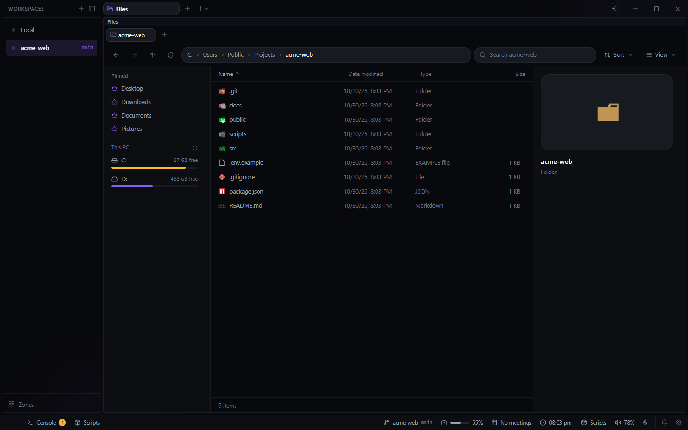

# Files for Deck

A file explorer in a pane: your drives, pinned folders, phones and servers, with tabs of its own, a
preview pane, and search by name and inside files. Open it from the **+** beside your tabs and
choose **Files**.

- **Places:** pinned folders (right-click a folder, Pin to the sidebar), this PC's drives with
  their free space, phones and cameras plugged in over USB, and the hosts in `~/.ssh/config`,
  opened over SSH as `host:/path`. A phone with USB debugging on also lists its debug builds'
  own folders, as Android Studio's Device Explorer does.
- **Views:** Details (name, date modified, type, size) or icons in four sizes, with Windows' own
  thumbnails. The Sort menu sorts and groups by name, date, type or size. Hidden files and the
  preview pane are switched in the View menu; the sidebar and the preview pane resize by their
  edge.
- **Preview pane:** pictures, videos and songs, text and code, a PDF's first page, and what the
  file is.
- **Opening:** a file opens where Deck opens its kind (a PDF in the PDF plugin, a page in the
  browser, code in the Editor), and anything Deck has nothing for opens in Windows' own app. Open
  with lists every choice. A folder can be opened as a Deck workspace from its menu.
- **Search:** names, and what is inside files (files .gitignore leaves out are skipped). A whole
  drive is not searched: open a folder on it first.
- **Changing files:** copy, cut and paste, drag to move or copy, drag a box to select, rename, new
  folder and file, the Recycle Bin and Delete for good. On this PC and phones the copy is Windows'
  own, with its progress and its question when a name is taken. Debug builds' folders take
  copies in and out, renames, deletes and new items. Copying between this PC and a server, or a
  server and a phone, is not possible yet.

## Keys

The list's own: arrows, Home, End, Page Up and Down (Shift to extend), Enter to open, Backspace up
a folder. While the explorer has focus: F2, Delete, Shift+Delete, Ctrl+C, Ctrl+X, Ctrl+V, Ctrl+A,
Ctrl+Shift+C (copy the path), Ctrl+Shift+N, F5, Alt+Left/Right/Up, Ctrl+F. Each can be changed in
Settings > Keybindings.

## Settings and data

**Files opened from Files** in Settings > Where things open: in a tab, or in a floating window.

Its tabs, pinned folders and view choices live in Deck's config on this machine: `files.json`.

**Needs** adb (on PATH, or Android Studio's) for debug builds' folders.
